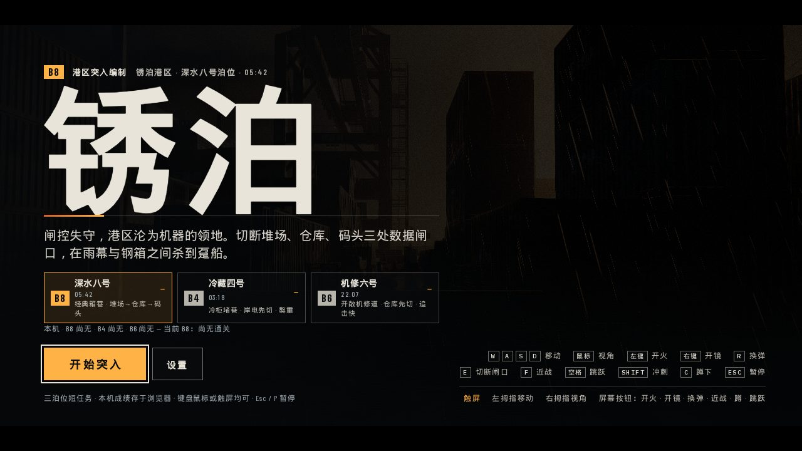
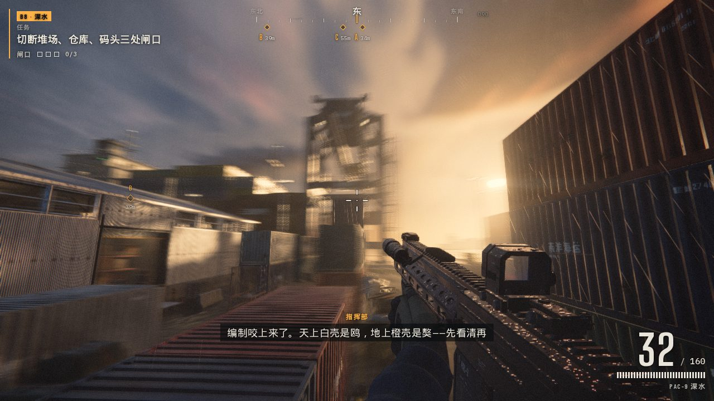
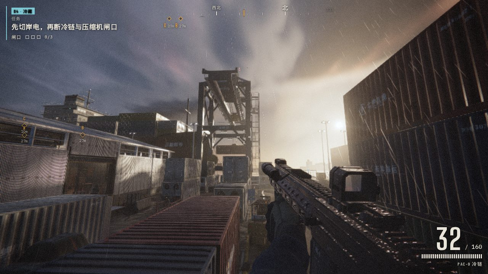
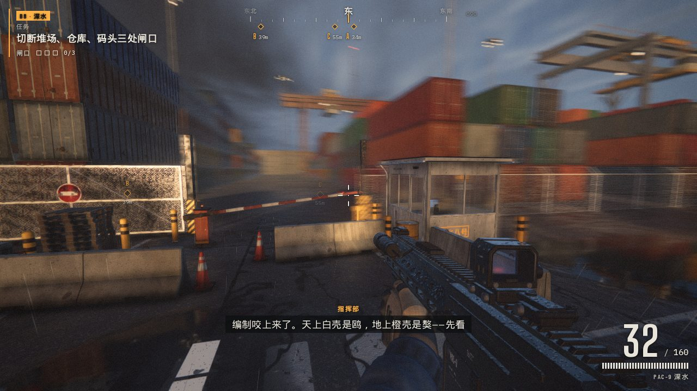
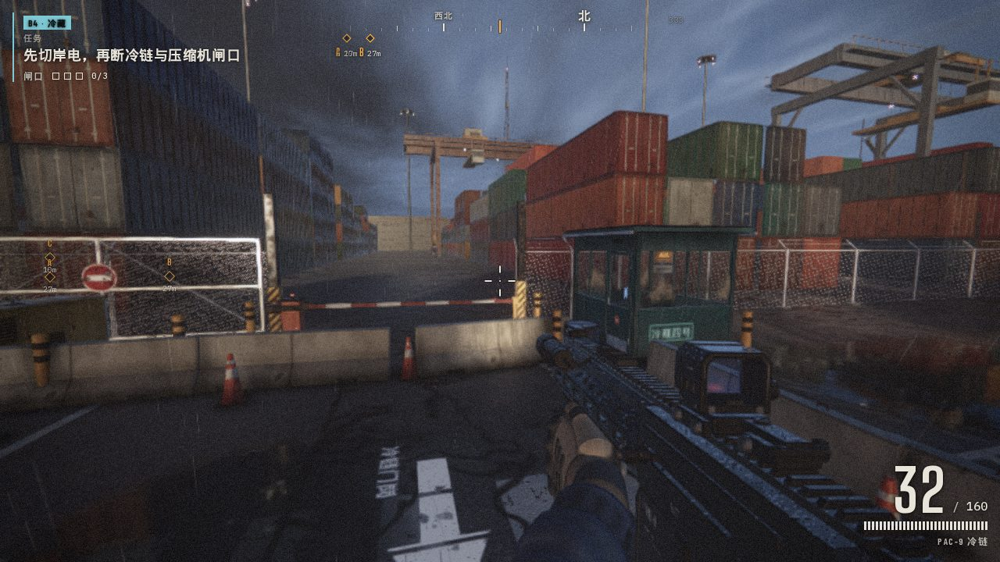
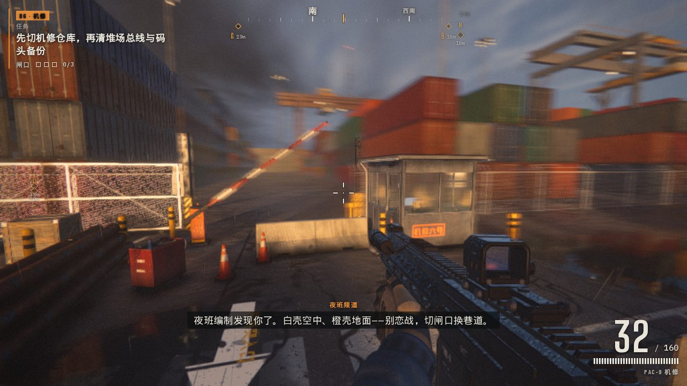
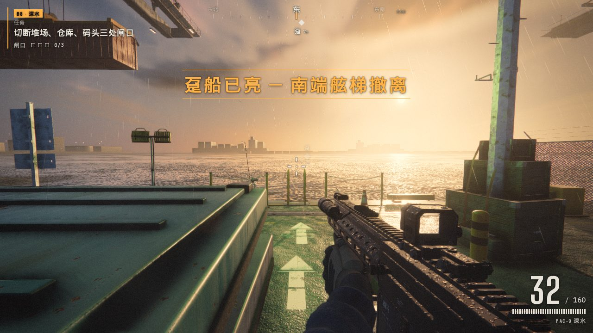

# 锈泊 · XIUBO

雨夜集装箱场，三泊位短任务 FPS。切断数据闸口，对抗空中「鸥」与地面「獒」，登趸船撤离。

纯静态 · 无账号 · 成绩仅存本机浏览器。Three.js r180，模块化源码与单文件 HTML 双交付。



## 三泊位

同一港区，三条体验不同的突入线——不是换皮，是起点、闸序、堆场几何、光声与战斗节奏都分开。

### B8 · 深水八号

经典箱巷：堆场 → 仓库 → 码头。钠黄暖色、密排龙门，均衡压迫下的「家场」节奏。



### B4 · 冷藏四号

冷柜堵巷，岸电先切。更密的雨、偏冷色调，獒多鸥少——贴湿岸推进再回切冷链。



### B6 · 机修六号

开敞北场，仓库先切。夜班钠橙、追击更快；管材与开敞视线逼你换掩体，别恋战。


### 门亭与撤离

闸口门亭招牌、色带与栏杆开合按泊位分开——深水黄、冷链青、机修橙。切完三闸，趸船亮灯，按住登船。

| 深水八号 | 冷藏四号 | 机修六号 |
| --- | --- | --- |
|  |  |  |



## 本地开发

需要 Node.js 20.19+ / 22.12+，以及支持 WebGL2 的浏览器。

```bash
npm install
npm run dev
```

打开 `http://127.0.0.1:8743`，在标题屏选择泊位，再点 **开始突入**。

```bash
npm run build          # 常规静态站点 → dist/（含本地字体）
npm run build:single   # 单文件 HTML → dist-single/index.html
npm run release        # 单文件构建并同步到 release/xiubo.html
npm run preview        # 预览 dist/（先 build）
npm run preview:single # 预览 dist-single/（先 build:single）
```

单文件版联网时可拉中文字体（Google Fonts CDN）；断网仍可玩，仅字体回退。常规 `dist/` 打进了 `public/fonts/`，离线字体更完整。

## 部署 / 上线

锈泊是**纯静态前端**：无后端、无账号服务。任选一种交付即可。

### 方案 A — 静态站点（`dist/`）

适合 GitHub Pages、Netlify、Cloudflare Pages、Nginx、对象存储静态网站等。

```bash
npm install
npm run check
npm run build
```

把 `dist/` 整目录挂到站点根（或子路径）。仓库已设 `base: "./"`，相对资源路径在子目录托管也能工作。

**GitHub Pages（示例）**

1. `npm run build`
2. 将 `dist/` 内容推到 `gh-pages` 分支，或在 Settings → Pages 选择 GitHub Actions / 部署该目录
3. 项目页（`https://<user>.github.io/xiubo/`）与用户页均可；`dist/` 含 `.nojekyll`，避免 Jekyll 干扰
4. 本地核对：`npm run preview` → `http://127.0.0.1:8743`

**任意静态主机**

上传 `dist/` 全部文件，确保 `index.html` 为入口，MIME 正常（`.js` → `application/javascript`，`.css` → `text/css`，字体 `woff2` 可访问）。HTTPS 推荐（指针锁定 / AudioContext 在部分浏览器要求安全上下文）。

### 方案 B — 单文件 HTML（发版工件）

适合邮件分发、内网 U 盘、或「丢一个文件就能开」的场景。

```bash
npm run release
# → dist-single/index.html
# → release/xiubo.html   ← 仓库内已提交的可玩快照
```

用浏览器直接打开 `release/xiubo.html`，或放到任意静态目录。本地冒烟：`npm run preview:single` → `http://127.0.0.1:8744`。

发版前建议：`npm run check && npm run build && npm run release`，确认 `dist/` 与 `release/xiubo.html` 均来自当前 `main`。

### 上线核对清单

| 项 | 期望 |
| --- | --- |
| `npm run check` | 语法 / 导入 / 归档校验通过 |
| `npm run build` | 产出 `dist/index.html` + `assets/` + `fonts/` |
| `npm run release` | 更新 `release/xiubo.html` |
| 标题屏 | 品牌「锈泊」、泊位可选、**开始突入** |
| 音频 | 首次手势后有雨/电台；`/?noaudio=1` 可静音排障 |
| 设置 | 本机 `localStorage` 键 `xiubo.settings.v1` |

不做：服务端存档、账号、实时联机。成绩仅局内结算；本机最佳通关 / 阵亡次数见下方。

## 操作

| 动作 | 按键 |
| --- | --- |
| 移动 / 视角 | WASD / 鼠标 |
| 开火 / 开镜 | 左键 / 右键 |
| 换弹 / 近战 | R / F |
| 跳跃 / 冲刺 / 蹲 | 空格 / Shift / C |
| 切断闸口 / 登船 | 靠近后按住 E |
| 暂停 | Esc 或 P |

触屏：左拇指移动、右半屏视角；屏幕按钮含开火、开镜、换弹、近战、蹲、跳跃与互动。

设置：`localStorage` 键 `xiubo.settings.v1`。各泊位本机最佳通关 / 阵亡：`xiubo.scores.v1`（无账号、无后端）。

## 源码地图

见 [`docs/DEVELOPMENT.md`](docs/DEVELOPMENT.md)。入口 `src/game.js` → `app/runtime.js`。

## 调试

| URL | 作用 |
| --- | --- |
| `/?q=low` / `medium` / `high` / `ultra` | 画质 |
| `/?seed=4207` | 固定随机种子 |
| `/?mission=b8` / `b4` / `b6` | 选择泊位（深水八号 / 冷藏四号 / 机修六号） |
| `/?autostart=1` | 跳过标题直接开局 |
| `/?noaudio=1` | 静音模块 |
| `/?bench=1` | 基准巡游 |

浏览器控制台：`window.__G`、`window.__stats()`。

PR 审阅用的固定种子截图约定与脚本见 [`docs/PLAYTEST.md`](docs/PLAYTEST.md)（`npm run playtest:shots`，非日常门禁）。
